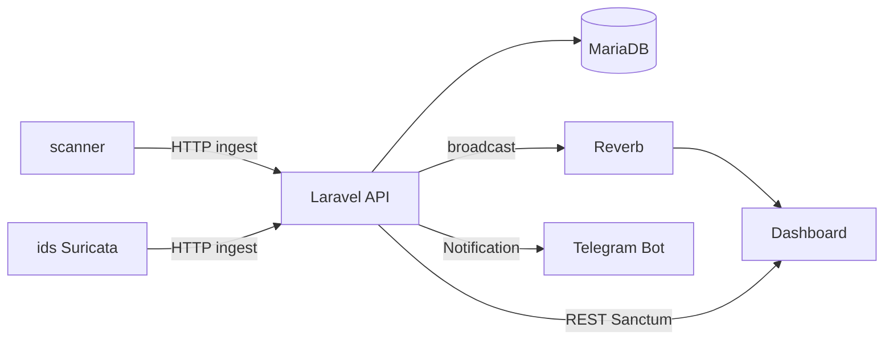

# Argos NetSec: Plan de implementación

Oct 15, 2026 · @CofeeBlcks

## Perfil MVP

Argos es un sistema de seguridad en redes para **lab / red doméstica propia**, que corre **nativo en Linux** (Arch / Omarchy), sin Docker.

| Aspecto | Decisión |
| --- | --- |
| Objetivo | Inventario de dispositivos, detección de cambios y alertas |
| Alertas | Dashboard en vivo + bot de Telegram |
| Alcance de red | Solo redes propias o con autorización escrita |
| Bind de servicios | `127.0.0.1` (API, Reverb, dashboard en desarrollo) |
| Escaneos | Conservadores (`-T2` o `-T3`); deep scan semanal |

**Fuera de v1:** bloqueo de IP, Discord/correo, multi-host, agentes remotos, Docker.

**Estado actual del repo.** Existen esqueletos `api/` (Laravel 13, PHP `^8.3`) y `dashboard/` (Untitled UI + Vite/React). Faltan `contracts/`, `scanner/`, `ids/`, `deploy/`, `Makefile` y `.mise.toml`. El `.gitignore` raíz no debe ignorar `api/` ni `dashboard/` enteros.

## Decisiones de arquitectura

Argos es un monorepo: dos sensores en Python envían datos por HTTP a una API Laravel; el dashboard React los consume por REST y WebSocket.

| Decisión | Elección | Motivo |
| --- | --- | --- |
| Repositorio | Monorepo `argos-netsec` | Un desarrollador, contratos compartidos |
| API | Laravel 13, PHP 8.3+ | Stack de casa; ingesta, auth, colas y WebSocket |
| Patrón API | Actions + ApiResponse (chancho/prime/yeapp/unipaz) | Mismo estilo que el resto de proyectos |
| Base de datos | MariaDB (prod local); SQLite en memoria (tests) | Driver MySQL de Laravel; tests rápidos |
| Tiempo real | Laravel Reverb | WebSocket oficial, sin servicio externo |
| Sensores | Python (scanner e IDS) + Suricata | Nmap, Scapy y `eve.json` |
| Dashboard | Vite + React (Untitled UI actual) | Modo live local + modo demo estático |
| Ejecución | Nativa, sin Docker | Acceso directo a la interfaz de red |
| Automatización | `Makefile` en la raíz | Comandos cortos |
| Orden de desarrollo | ops → contracts → api → scanner → dashboard → ids | Cada fase deja algo verificable |

**Principio de diseño.** Los sensores nunca escriben en la base de datos: envían resultados a la API con un token propio. Solo ellos necesitan privilegios elevados; API, MariaDB y dashboard corren como usuario normal.

## Defaults cerrados

| Tema | Valor |
| --- | --- |
| Descubrimiento | Cada **5 minutos** |
| Escaneo profundo | **Semanal** + `make scan` bajo demanda |
| Velocidad Nmap | `-T2` o `-T3` |
| Canal externo | Solo **Telegram** |
| Umbral Telegram | Severidad **`high`** y **`critical`** |
| Dashboard | Todas las severidades |
| Anti-ruido Telegram | No reenviar la misma `(rule, src_ip, dst_ip)` en **15 min** |
| Retención de alertas/eventos | **30 días** |
| Mapa de red | **Cytoscape** |
| Tests API | **SQLite** en memoria |
| PHP | **8.3+** (Laravel 13 soporta 8.3–8.5) |

## Estructura del monorepo

```text
argos-netsec/
├── contracts/      # JSON Schema, OpenAPI, fixtures
├── scanner/        # Python: descubrimiento y escaneo profundo
├── ids/            # Suricata + lector Python
├── api/            # Laravel 13: API, MariaDB, Reverb, alertas
├── dashboard/      # Vite + React (Untitled UI)
├── deploy/         # unidades systemd, env.md
├── docs/
│   ├── Argos NetSec Plan de implementación.md
│   └── logo/
│       └── logo.svg   # marca oficial (fuente de la paleta)
├── Makefile
├── .mise.toml      # versiones de PHP, Node y Python
└── .gitignore      # .env, vendor, node_modules, .pcap, logs, dumps
```

| Carpeta | Tecnología | Responsabilidad | Permisos |
| --- | --- | --- | --- |
| `contracts` | JSON Schema, OpenAPI | Formatos de device, service, event, alert | Ninguno |
| `scanner` | Python | Descubrir, comparar línea base, enviar a la API | Capacidades de red |
| `ids` | Suricata + Python | Detectar tráfico sospechoso y enviar alertas | Captura de paquetes |
| `api` | Laravel 13, MariaDB | Ingesta, almacenamiento, consultas, WebSocket, Telegram | Usuario normal |
| `dashboard` | Vite, React | Resumen, mapa, exposición, actividad; live o demo | Usuario normal |
| `deploy` | systemd | Instalar y arrancar servicios | Root solo al instalar |

El frontend demo se puede publicar en Vercel eligiendo `dashboard/` como raíz, sin exponer el resto del monorepo.

## Arquitectura y flujo de datos



1. Sensores observan la red y envían a `/api/v1/ingest/...` con token de sensor.
2. La API valida, persiste (vía Actions/Jobs), asocia IPs a dispositivos cuando puede.
3. Eventos y alertas se emiten por Reverb; alertas `high`/`critical` también van a Telegram.
4. El dashboard consulta historial por REST (Sanctum) y recibe novedades por Echo; si Reverb falla, usa polling de respaldo.

## Contratos

`contracts/` es la fuente única de formatos. Python, Laravel y React se ajustan a ella, nunca al revés.

```text
contracts/
├── schemas/
│   ├── device.schema.json
│   ├── service.schema.json
│   ├── event.schema.json
│   └── alert.schema.json
├── openapi.yaml
└── fixtures/
    └── data.json
```

| Consumidor | Qué toma | Cómo |
| --- | --- | --- |
| `scanner` e `ids` | Modelos de envío | Pydantic desde JSON Schema |
| `api` | Validación de entrada | Form Requests alineados a esquemas + tests con fixtures |
| `dashboard` | Tipos de respuesta | TypeScript desde JSON Schema u OpenAPI |

**Regla de cambios.** Todo campo nuevo se agrega primero en `contracts/` y después en cada consumidor. `make contracts` regenera modelos Python y tipos TypeScript.

**Versionado.** OpenAPI versionado; endpoints de ingesta bajo `/api/v1/`.

## API: Laravel 13 (patrón de casa)

La API es el único componente que escribe en MariaDB. Debe seguir el mismo patrón arquitectónico que **chancho**, **prime**, **yeapp** y **unipaz** (referencia principal: `chancho/api` y `prime/api`).

### Capas

```text
Route (api/v1)
  → Controller (Http/Controllers/API/)
    → Form Request
      → Action::execute()
        → Model / Job / Notification / Event
      ← JsonResource + ApiResponse
```

No se usan repositories, DTOs ni Laravel Modules. La lógica de negocio vive en **Actions**; los controllers son delgados.

### Estructura `api/app`

```text
api/app/
├── Actions/
│   ├── Ingest/          # StoreScan, StoreEvents, StoreAlert
│   ├── Devices/         # AuthorizeDevice, ...
│   ├── Alerts/          # UpdateAlertStatus, ...
│   └── Auth/            # flujos no triviales de login
├── Constants/
│   ├── ApiStatuses.php
│   └── ErrorMessages.php
├── Helpers/
│   └── MessageHelper.php
├── Http/
│   ├── Controllers/API/
│   ├── Middleware/      # AuthenticateSensor, ...
│   ├── Requests/
│   └── Resources/       # camelCase
├── Jobs/
├── Notifications/       # AlertTelegramNotification
├── Events/              # AlertCreated, EventCreated (broadcast)
├── Models/
├── Services/            # solo cross-cutting (p.ej. ExportDemoData)
└── Traits/Api/
    └── ApiResponse.php
```

### Convenciones

| Tema | Convención |
| --- | --- |
| Envelope JSON | `{ status, message, data, meta }` (`status`: `success` \| `error`) |
| Actions | Clases `final` con `execute(...)`; transacciones y log cuando aplique |
| Controllers | Type-hint Form Request → Action → `successResponse` / `errorResponse` |
| Resources | `JsonResource`, claves camelCase, `whenLoaded()` |
| Form Requests | Mensajes de validación en español |
| Excepciones | Render JSON centralizado en `bootstrap/app.php` para `api/*` |
| Auth dashboard | Sanctum (`auth:sanctum`) |
| Auth sensores | Middleware/guard propio; token con hash en tabla `sensors` |
| Rutas | `routes/api.php` con `Route::prefix('v1')` |
| Tests | Pest (Feature + Unit de Actions) |
| Tooling | Pint, laravel/boost, `AGENTS.md` como en chancho/prime |

### Flujo ejemplo: ingest de alerta

1. `POST /api/v1/ingest/alerts` (middleware de sensor)
2. `Http/Controllers/API/Ingest/AlertController`
3. `StoreAlertRequest`
4. `Actions/Ingest/StoreAlert::execute()`
5. Persistencia → Event de broadcast → Job de Telegram si severidad ≥ `high`
6. Respuesta con `AlertResource` + `ApiResponse`

### Tablas (migraciones)

| Tabla | Campos principales |
| --- | --- |
| `devices` | mac (única), ip, hostname, vendor, os_guess, authorized, first_seen, last_seen, risk |
| `services` | device_id, port, protocol, name, version, cve_ids, severity, last_seen |
| `events` | occurred_at, type, device_id, detail (JSON) |
| `alerts` | occurred_at, rule, severity, src_ip, dst_ip, device_id (nullable), raw (JSON), status |
| `sensors` | name, kind (`scanner` \| `ids`), token_hash, last_seen_at |

`alerts.status`: `open` | `acked` | `false_positive`.

### Endpoints

| Método y ruta | Quién | Función |
| --- | --- | --- |
| `POST /api/v1/ingest/scan` | scanner | Dispositivos y servicios de un escaneo |
| `POST /api/v1/ingest/events` | scanner | Eventos de cambio |
| `POST /api/v1/ingest/alerts` | ids | Alertas del IDS |
| `GET /api/v1/devices`, `/services`, `/events`, `/alerts` | dashboard | Consultas con filtros y paginación |
| `GET /api/v1/summary` | dashboard | Cifras de Resumen (incluye alertas abiertas y latido de sensores) |
| `PATCH /api/v1/devices/{id}` | dashboard | Marcar dispositivo como autorizado |
| `PATCH /api/v1/alerts/{id}` | dashboard | `acked` o `false_positive` |
| `GET /api/v1/export/demo` | operador | Genera fixture anonimizado |

### Piezas de Laravel

- **Ingesta:** controllers delgados → Form Requests → Actions; trabajo pesado en Jobs (cola `database`).
- **Tiempo real:** ver sección **Reverb y WebSocket** (guía Unipaz).
- **Telegram:** `AlertTelegramNotification` vía Bot API (`TELEGRAM_BOT_TOKEN`, `TELEGRAM_CHAT_ID`). Solo `high`/`critical`. Anti-ruido 15 min. Si Telegram falla, la alerta sigue en DB y dashboard.
- **Autenticación:** token por sensor (hash en `sensors`); Sanctum para dashboard.
- **Exportador:** `php artisan argos:export-demo` escribe `contracts/fixtures/data.json` anonimizado.
- **Programador:** marcar sensores sin latido; limpiar alertas/eventos con más de 30 días.
- **Paquetes a instalar en fase API:** `laravel/sanctum`, `laravel/reverb`.

## Reverb y WebSocket (guía Unipaz)

Tomar como referencia la solución estable de **Unipaz** (`/srv/http/unipaz/api` + `gpaz`): env alineado, proceso Reverb aparte, eventos `ShouldBroadcastNow`, contrato de canal/evento documentado y **fallback HTTP** cuando el WS falla. Argos añade **canales privados + Sanctum** (Unipaz GPAZ usó canal público `gpaz.buses` sin `/broadcasting/auth`).

### Lecciones de Unipaz a copiar

| Lección | En Unipaz | En Argos |
| --- | --- | --- |
| Driver activo | `BROADCAST_CONNECTION=reverb` | Igual; en Pest/phpunit: `null` |
| Proceso aparte | `php artisan reverb:start` (puerto 8080) | Unidad `argos-reverb` / `make dev` |
| Bind vs host cliente | `REVERB_SERVER_HOST` (escucha) ≠ `REVERB_HOST` (alcanzable por el cliente) | Local: bind `127.0.0.1`; cliente `127.0.0.1` o `localhost` (consistente) |
| Credenciales | Mismos `REVERB_APP_ID` / `KEY` / `SECRET` en API y cliente | Igual + `VITE_REVERB_*` en dashboard |
| Esquema local | `REVERB_SCHEME=http`, puerto `8080` | Igual en lab |
| Eventos latentes | `ShouldBroadcastNow` (mapa en vivo) | `ShouldBroadcastNow` para alertas/eventos |
| Nombre de evento | `broadcastAs()` + cliente Echo con punto (`.BusLocationUpdated`) | `.AlertCreated`, `.EventCreated` |
| Fallback | Snapshot HTTP + refetch periódico en mapa | REST + polling en Actividad si Echo no conecta |
| Tests | `BROADCAST_CONNECTION=null` | Igual |

### Variables de entorno (API)

Documentar en `api/.env.example` y `deploy/env.md` (mismo patrón que Unipaz):

```env
BROADCAST_CONNECTION=reverb

REVERB_APP_ID=
REVERB_APP_KEY=
REVERB_APP_SECRET=
REVERB_HOST=127.0.0.1
REVERB_PORT=8080
REVERB_SCHEME=http
REVERB_SERVER_HOST=127.0.0.1
REVERB_SERVER_PORT=8080

VITE_REVERB_APP_KEY="${REVERB_APP_KEY}"
VITE_REVERB_HOST="${REVERB_HOST}"
VITE_REVERB_PORT="${REVERB_PORT}"
VITE_REVERB_SCHEME="${REVERB_SCHEME}"
```

Dashboard consume solo `VITE_REVERB_*` y `VITE_API_URL`. No mezclar `localhost` y `127.0.0.1` entre página, API y Reverb (cookies/CORS/auth fallan con hosts cruzados).

### Canales y auth (delta Argos)

Unipaz evitaba 403 en `/broadcasting/auth` con canal **público**. Argos necesita privacidad:

- Canales privados, p.ej. `PrivateChannel('argos.alerts')`, `PrivateChannel('argos.events')`.
- Registrar `channels` en `bootstrap/app.php` (como Unipaz).
- `Broadcast::routes(['middleware' => ['auth:sanctum']])` (o equivalente) para autorizar suscripción.
- `routes/channels.php`: solo usuarios autenticados del dashboard.
- Echo: `authEndpoint` = `{VITE_API_URL}/broadcasting/auth` + header `Authorization: Bearer {token}`.
- Probar explícitamente el 403: token ausente, token de sensor (no debe entrar), CORS.

### Eventos de broadcast

```text
app/Events/
├── AlertCreated.php    # ShouldBroadcastNow → private argos.alerts
└── EventCreated.php    # ShouldBroadcastNow → private argos.events
```

- `broadcastAs()`: nombre estable sin prefijo de clase.
- `broadcastWith()`: shape alineado al Resource / contrato OpenAPI (como `BusLocationResource` en Unipaz).
- Emitir **después** de persistir y de fijar estado visible (en Unipaz: marcar bus ACTIVE antes del broadcast en login).

### Cliente dashboard (Vite + Echo)

Argos es SPA web → **Laravel Echo + pusher-js** (no Expo). Config mínima:

```ts
new Echo({
  broadcaster: 'reverb',
  key: import.meta.env.VITE_REVERB_APP_KEY,
  wsHost: import.meta.env.VITE_REVERB_HOST,
  wsPort: Number(import.meta.env.VITE_REVERB_PORT),
  wssPort: Number(import.meta.env.VITE_REVERB_PORT),
  forceTLS: import.meta.env.VITE_REVERB_SCHEME === 'https',
  enabledTransports: import.meta.env.VITE_REVERB_SCHEME === 'https' ? ['wss'] : ['ws'],
  authEndpoint: `${import.meta.env.VITE_API_URL}/broadcasting/auth`,
  auth: { headers: { Authorization: `Bearer ${token}` } },
});
```

- Escuchar `.AlertCreated` / `.EventCreated` (punto inicial = nombre custom de `broadcastAs`).
- Si env Reverb incompleto: degradar a polling y avisar en consola (patrón GPAZ).
- `laravel-echo` + `pusher-js` en `dashboard/`; no usar Echo en clientes RN (Unipaz lo descartó por Metro).

### Errores de despliegue / local que Unipaz resolvió (checklist Argos)

1. **`BROADCAST_CONNECTION` no es `reverb`** → eventos no salen al WS (quedan en `log`/`null`).
2. **Reverb no arrancado** → cliente conecta a puerto muerto; siempre proceso aparte o systemd.
3. **Host no alcanzable** → en Unipaz dispositivos LAN necesitaban IP de la máquina, no `localhost`. En Argos lab (todo en el mismo PC) usar `127.0.0.1` de forma uniforme.
4. **Key/secret distintos** entre API y `VITE_REVERB_*` → handshake fallido.
5. **`REVERB_SCHEME` / `forceTLS` desalineados** → WS vs WSS incorrecto; mixed content si la página es HTTPS y el WS es `ws://`.
6. **Nombre de evento mal escuchado** → Echo espera `.Nombre`; pusher-js crudo espera `Nombre` sin punto.
7. **Confiar solo en el WS** → sin snapshot REST el usuario llega “antes” del primer evento; siempre hidratar por HTTP y opcionalmente refetch.
8. **Auth de canal privado** (solo Argos) → 403 en `/broadcasting/auth` si falta Sanctum, middleware o CORS; Unipaz lo evitó con canal público, Argos debe probarlo en fase 2/4.
9. **`APP_URL` inconsistente** con la URL real de la API → firmas/redirects/auth raros; alinear con `VITE_API_URL`.
10. **Tests hit Reverb** → fijar `BROADCAST_CONNECTION=null` en `phpunit.xml`.

### Operación

| Contexto | Qué correr |
| --- | --- |
| Dev | `php artisan reverb:start` junto a API, queue y Vite (`make dev`) |
| Lab persistente | unidad systemd `argos-reverb` |
| Contrato | Documentar canal, `broadcastAs`, payload y env en `deploy/env.md` (modelo: `unipaz/docs/api/gpaz-contract.md` § Realtime) |

**Producción detrás de proxy (si algún día se publica):** terminar TLS en el proxy, `Upgrade`/`Connection` hacia Reverb, `REVERB_SCHEME=https`, cliente solo `wss`. Fuera del MVP lab localhost, pero dejar la nota para no repetir errores de despliegue.

## Sistema de alertas

### Persistencia y fan-out

1. Alerta normalizada según `alert.schema.json`.
2. Deduplicación razonable en API cuando aplique.
3. Guardar con `status = open`.
4. Broadcast Reverb al canal privado.
5. Si `severity` es `high` o `critical` → encolar Telegram (respetando ventana de 15 min).

### Dashboard

- **Resumen:** contadores de alertas abiertas y por severidad; latido de sensores.
- **Actividad:** timeline + tabla filtrable; Echo en vivo; **polling de respaldo** si Reverb no conecta.
- Badge/toast global de alertas abiertas.
- Acciones: acusar recibo y marcar falso positivo (`PATCH /api/v1/alerts/{id}`).

### Telegram

- Mensaje: regla, severidad, src/dst IP, hostname si hay `device_id`.
- Secretos solo en `.env` de la API; documentados en `deploy/env.md`.
- No loguear el bot token.
- Fallo de envío no bloquea la respuesta de ingest ni el broadcast.

## Scanner

```text
scanner/
├── pyproject.toml
├── src/argos_scanner/
│   ├── config.py
│   ├── discovery.py     # arp-scan, Nmap -sn
│   ├── deepscan.py      # Nmap -sV -O -oX
│   ├── baseline.py      # comparar y generar eventos
│   ├── vendors.py       # OUI → fabricante
│   ├── client.py        # HTTP con reintentos y cola local
│   └── main.py          # APScheduler
└── tests/
```

| Tarea | Frecuencia | Herramienta | Resultado |
| --- | --- | --- | --- |
| Descubrimiento | Cada 5 min | arp-scan, Nmap `-sn` | Dispositivos y eventos de cambio |
| Escaneo profundo | Semanal o `make scan` | Nmap `-sV -O -oX` | Servicios, versiones, SO |
| Cruce CVE | Tras deep scan | Script `vulners` de Nmap | CVE y severidad |

**Línea base.** La API es la fuente de verdad de dispositivos autorizados. El scanner genera eventos ante MAC no autorizada, IP duplicada, puerto nuevo u host que desaparece.

**Envío.** POST a `/api/v1/ingest/...` con reintentos y cola local si la API no responde.

**Alcance.** CIDR objetivo debe pertenecer a una interfaz local; plantilla `-T2`/`-T3`.

## IDS

```text
ids/
├── suricata/
│   ├── suricata.yaml
│   └── rules/argos.rules
├── pyproject.toml
├── src/argos_ids/
│   ├── config.py
│   ├── eve_reader.py
│   ├── normalize.py
│   ├── detectors/
│   │   ├── arp_spoof.py
│   │   └── dns_anomaly.py   # fase 5b si hay ruido
│   ├── client.py
│   └── main.py
└── tests/
```

| Detección | Dónde | Nota |
| --- | --- | --- |
| Escaneo de puertos | Suricata (umbral) | Muchos SYN a puertos distintos |
| Fuerza bruta SSH/RDP | Suricata (umbral) | Muchas conexiones al mismo servicio |
| DNS sospechoso | Suricata y/o `dns_anomaly.py` | Opcional al inicio |
| ARP spoofing | `arp_spoof.py` (Scapy) | Suricata no cubre bien ARP |
| Picos de tráfico | Suricata estadísticas/umbral | Posible DoS |

**Enlace con inventario.** La API asocia `device_id` cuando la IP coincide con un dispositivo conocido.

**Reglas.** Partir de reglas gratuitas con `suricata-update` + `argos.rules` propias; pocas reglas al inicio.

**Privilegios.** Suricata con capacidades de red; el lector Python solo lee `eve.json`.

**Cliente HTTP.** Mismo contrato de reintentos y cola local que el scanner (código duplicado aceptable en v1; factor común opcional después).

## Identidad visual y paleta

Marca oficial: [`docs/logo/logo.svg`](logo/logo.svg). Colores extraídos del SVG (paleta **flat**, sin degradados ni glows como base).

### Colores de marca (logo)

| Token | Hex | Rol |
| --- | --- | --- |
| `--argos-ink` | `#0A0C0E` | Fondo del logo / tinta del sistema |
| `--argos-signal` | `#ED1C24` | Rojo de marca (alerta, acento primario) |
| `--argos-snow` | `#F2F2F2` | Marca clara / texto principal sobre ink |

### Superficies (tema oscuro por defecto)

El logo es oscuro; el producto usa **tema oscuro flat** como default. Sin púrpuras ni cremas.

| Token | Hex | Uso |
| --- | --- | --- |
| `--surface-0` | `#0A0C0E` | Fondo de app / canvas |
| `--surface-1` | `#14181C` | Sidebar, header, paneles |
| `--surface-2` | `#1C2228` | Filas, inputs, bloques de contenido |
| `--surface-3` | `#262E36` | Hover, selección, chips inactivos |
| `--border` | `#2E3740` | Bordes y divisores (1px sólido) |

### Texto

| Token | Hex | Uso |
| --- | --- | --- |
| `--text-primary` | `#F2F2F2` | Títulos y cuerpo |
| `--text-secondary` | `#A8B0B8` | Subtítulos, labels |
| `--text-muted` | `#6B757E` | Metadatos, timestamps, placeholders |
| `--text-on-signal` | `#FFFFFF` | Texto sobre botones/badges rojos |

### Semántica (severidad, riesgo, estado)

Planos y legibles en mapa Cytoscape, badges y gráficos Recharts.

| Token | Hex | Uso |
| --- | --- | --- |
| `--severity-critical` | `#ED1C24` | Critical (= marca) |
| `--severity-high` | `#E35D0F` | High |
| `--severity-medium` | `#C9A227` | Medium |
| `--severity-low` | `#2A9D8F` | Low / autorizado / OK |
| `--severity-info` | `#3A7CA5` | Info / neutro operativo |
| `--state-unknown` | `#6B757E` | Dispositivo desconocido / sin clasificar |
| `--state-focus` | `#3A7CA5` | Focus ring / enlace activo (no rojo) |

### Acentos de UI

| Token | Hex | Uso |
| --- | --- | --- |
| `--accent` | `#ED1C24` | CTA primario, badge de alerta abierta, logo |
| `--accent-muted` | `#8B1218` | Hover del acento, fondo de alerta sutil |
| `--link` | `#3A7CA5` | Enlaces (no competir con el rojo de alerta) |

### Reglas de uso

- **Flat:** rellenos sólidos; sin sombras multicapa ni glow. Un borde `--border` basta para separar.
- **Rojo solo para señal:** CTAs críticos, severidad critical, dispositivos no autorizados. No teñir toda la UI de rojo.
- **Logo:** usar `docs/logo/logo.svg` (o copia en `dashboard/public/logo.svg`). Fondo de marca = `--argos-ink`.
- **Telegram / mensajes externos:** texto plano; no depende de la paleta web.
- **Implementación dashboard:** CSS variables en `:root` (o tema Tailwind alineado a estos hex). Cytoscape y Recharts deben consumir los mismos tokens de severidad.
- **Contraste:** texto `--text-primary` sobre `--surface-0`…`2`; texto `--text-on-signal` sobre `--accent`.

### Mapa rápido marca → producto

```text
Logo ink (#0A0C0E)  → surface-0, fondos
Logo signal (#ED1C24) → accent, critical, no autorizado
Logo snow (#F2F2F2) → text-primary, glifo del logo
```

## Dashboard

Partir del starter Untitled UI ya presente. Layout de producto: **Untitled UI Dashboards 02 → Dashboard 04** (header navigation horizontal, métricas, gráfico, tablas en cards). Marca Argos (logo + `#ED1C24`) sobre tokens del kit; tema oscuro por defecto.

```text
dashboard/src/
├── api/          # cliente HTTP y tipos desde contracts
├── realtime/     # Laravel Echo + Reverb (+ fallback polling)
├── data/         # fuente: api o demo (data.json)
├── views/        # Resumen, MapaRed, Exposicion, Actividad
├── styles/       # tokens CSS (--argos-*, --surface-*, --severity-*)
└── components/
```

| Vista | Contenido | Visualización |
| --- | --- | --- |
| Resumen | Totales, desconocidos, alertas abiertas, riesgo, latido sensores | Cifras |
| Mapa de red | Dispositivos por riesgo/autorización | Cytoscape (colores `--severity-*` / `--state-*`) |
| Exposición | Puertos, servicios, CVE | Barras + tabla |
| Actividad | Alertas y eventos en el tiempo | Timeline + tabla en vivo |

**Auth (patrón SAGA Unipaz).** Login obligatorio (`/login`) con split-screen Untitled UI ([login-split-quote-image-01](https://www.untitledui.com/react/components/log-in-pages/login-split-quote-image-01)); `AuthProvider` + `ProtectedRoute` + token `argos_access_token`; API `POST /api/v1/auth/login` (email/password Sanctum).

**Modo live.** Sanctum + Echo según sección **Reverb y WebSocket**; `VITE_API_URL`, `VITE_REVERB_*`. Hidratar Actividad por REST al montar; Echo solo para deltas; polling si Reverb no conecta (patrón GPAZ).

**Modo demo.** `VITE_DEMO=true` usa fixtures; login demo con `admin@argos.local` / `password` (sin API).

**Librerías.** React Router, TanStack Query, Recharts (ya en el starter), Cytoscape, Laravel Echo + pusher-js.

**Marca en UI.** Logo en header/nav a tamaño hero de producto (nombre Argos visible junto al símbolo); no reducir la marca a un favicon sin nombre.

## Operación local

| Comando | Qué hace |
| --- | --- |
| `make setup` | Dependencias de api/scanner/ids/dashboard; copia `.env.example` |
| `make contracts` | Regenera Pydantic y tipos TypeScript |
| `make migrate` | Migraciones Laravel en MariaDB |
| `make dev` | API, Reverb, queue worker, dashboard |
| `make scan` | Escaneo profundo inmediato |
| `make ids` | Suricata + lector (con chequeo de interfaz) |
| `make test` | Pest (api), tests Python, tests dashboard |
| `make demo` | Export anonimizado + build demo |
| `make install-services` | Unidades systemd de `deploy/` |

### Servicios systemd

| Unidad | Proceso | Usuario |
| --- | --- | --- |
| `argos-api` | Servidor PHP de la API | Normal |
| `argos-reverb` | `php artisan reverb:start` | Normal |
| `argos-queue` | `php artisan queue:work` | Normal |
| `argos-scanner` | Scanner Python | Dedicado + capacidades de red |
| `suricata` / `argos-ids` | Suricata + lector | Dedicado + captura |

### Variables de entorno

Cada subproyecto tiene `.env.example` versionado y `.env` ignorado. En `deploy/env.md`: URL API, tokens de sensor, Telegram y bloque **Reverb** completo (`REVERB_*`, `REVERB_SERVER_*`, `VITE_REVERB_*`, bind vs host). Misma disciplina que Unipaz `api/.env.example` + env Reverb del cliente.

### `.gitignore` raíz (correcto)

Versionar `api/` y `dashboard/`. Ignorar: `.env`, `api/vendor/`, `api/node_modules/`, `dashboard/node_modules/`, `.pcap`, logs, dumps de MariaDB, `.netlify`. **No** ignorar las carpetas `api` y `dashboard` enteras.

### Versiones

Fijar PHP 8.3+, Node y Python en `.mise.toml` (o documentar en `docs/` si no se usa mise).

## Seguridad y privilegios

| Riesgo | Medida |
| --- | --- |
| Sensores con demasiados permisos | Usuario dedicado + `setcap cap_net_raw,cap_net_admin+eip` |
| Uso no autorizado de ingest | Token por sensor con hash, revocable |
| Acceso al dashboard | Sanctum; API y Reverb en `127.0.0.1` |
| Fuga de datos | `.gitignore` correcto; solo fixtures ficticios en git |
| Privacidad | Metadatos de alertas, no payload de paquetes |
| Saturar equipos frágiles | `-T2`/`-T3`, deep scan semanal |
| Escaneo fuera de alcance | CIDR validado contra interfaces locales |
| Secretos Telegram | Solo `.env`; nunca en logs ni fixtures |

**Alcance legal.** Solo redes propias o con autorización escrita.

**Bloqueo de IP.** No incluido en v1.

## Fases de desarrollo

No se avanza de fase hasta cumplir el criterio de cierre.

| Fase | Entregable | Criterio de cierre |
| --- | --- | --- |
| 0 Ops | `Makefile`, `.mise.toml`, `.gitignore` corregido, `deploy/env.md` | Setup documentado y reproducible |
| 1 Contracts | Schemas, OpenAPI, fixtures | `make contracts` + fixtures válidos contra schemas |
| 2 API | Migraciones, Actions, ingest, Sanctum, Reverb (guía Unipaz), colas, Telegram | Ingest → DB + WS en canal privado; auth `/broadcasting/auth` OK; `high+` a Telegram |
| 3 Scanner | Discovery, deep scan, baseline, client | MAC nueva → evento; `make scan` funciona |
| 4 Dashboard | 4 vistas, live + demo, UI de alertas, tokens de paleta | Badge/Actividad en vivo; acked / false_positive; UI con paleta Argos |
| 5 IDS | Suricata, eve reader, arp_spoof | Alerta de lab → dashboard (+ Telegram si aplica) |

Orden: **0 → 1 → 2 → 3 → 4 → 5**. Telegram queda operativo desde la fase 2 (probado con ingest manual).

## Riesgos

| Riesgo | Impacto | Mitigación |
| --- | --- | --- |
| Falsos positivos IDS | Alertas ignoradas | Pocas reglas al inicio; marcar `false_positive` |
| Contratos desincronizados | Sensores/API rotos | `make contracts` + tests con fixtures |
| Reverb caído / mal configurado | Actividad sin live | Guía Unipaz: env alineado, proceso aparte, polling; ver checklist de errores Reverb |
| 403 en `/broadcasting/auth` | Echo no suscribe canal privado | Sanctum en Broadcast::routes; Bearer en Echo; probar en fase 2/4 |
| Interfaz Suricata incorrecta | Sin alertas | Config + chequeo en `make ids` |
| Spam Telegram | Fatiga | Umbral high+ y ventana 15 min |
| Paquetes Arch (Suricata, arp-scan) | Instalación distinta | Verificar con `pacman`/`yay` antes de fase 5 |

## Listo para desarrollo

Este documento es el plan de trabajo cerrado del MVP. **El desarrollo de código comienza solo cuando se indique explícitamente**, empezando por la fase 0 (ops) y luego contracts.

Checklist previo al código:

- [x] Perfil MVP lab/doméstico definido
- [x] Alertas dashboard + Telegram definidas
- [x] Defaults de intervalos, retención y umbrales cerrados
- [x] Patrón API alineado a chancho/prime/yeapp/unipaz
- [x] Fases con criterio de cierre
- [x] Paleta flat y logo (`docs/logo/logo.svg`) definidos
- [x] Reverb/WebSocket documentado con guía Unipaz (api + gpaz)
- [x] Fase 0 ops (Makefile, mise, deploy, gitignore, README)
- [x] Fase 1 contracts (schemas, OpenAPI, fixtures)
- [x] Fase 2 API base (Actions, ingest, Sanctum, Reverb config, Telegram job, tests)
- [x] Fase 3 scanner (discovery, deepscan, baseline, client, tests)
- [x] Fase 4 dashboard Argos UI (4 vistas, paleta, demo, Echo stub)
- [x] Fase 5 IDS (Suricata stub, eve reader, normalize, arp_spoof, tests)

