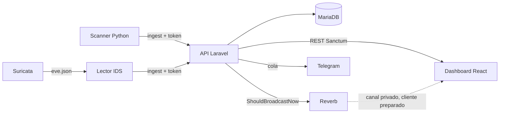

# Manual de funcionamiento

Argos NetSec observa una red local, guarda lo que ve y lo muestra en un panel. Los sensores no escriben en MariaDB. Hablan por HTTP con la API, y solo la API persiste, emite eventos y encola Telegram.

El trazo punteado es el camino previsto del WebSocket. Hoy las pantallas no se suscriben a Echo: Actividad se refresca por HTTP. La API sí publica en Reverb en cuanto hay un evento o una alerta.

## Piezas

| Carpeta | Proceso | Privilegio |
| --- | --- | --- |
| `scanner/` | Descubrimiento, deep scan, comparación con la línea base | Captura / ARP en la LAN |
| `ids/` | Suricata más un lector Python de `eve.json` y, si se activa, un detector ARP | Captura en la interfaz |
| `api/` | Laravel 13: ingesta, consultas, Sanctum, Reverb, cola | Usuario normal |
| `dashboard/` | Vite + React. Cuatro pantallas | Usuario normal |
| `contracts/` | JSON Schema, OpenAPI y fixtures. Fuente de los formatos | Ninguno |
| `deploy/` | Unidades systemd y la tabla de variables | Root solo al instalar unidades |

MariaDB guarda dispositivos, servicios, eventos, alertas, sensores, usuarios y la cola. Los tests de la API usan SQLite en memoria.

## Contratos y respuestas

`contracts/schemas/` define device, service, event y alert. `contracts/openapi.yaml` describe la API. Un campo nuevo entra primero en `contracts/` y después en Python, Laravel y TypeScript. `make contracts` comprueba que esos archivos existan; no regenera modelos.

Toda respuesta JSON de la API usa el sobre `{ status, message, data, meta }`, con `status` en `success` o `error`. Las claves de los resources van en camelCase.

## Autenticación

Hay dos puertas.

**Dashboard.** `POST /api/v1/auth/login` devuelve un token de Sanctum. El resto de lecturas (`/devices`, `/services`, `/events`, `/alerts`, `/summary`) y los PATCH de dispositivo y alerta exigen `Authorization: Bearer`. `POST /api/v1/auth/logout` revoca el token. `GET /api/v1/auth/me` devuelve el usuario.

**Sensores.** El middleware `sensor` compara el Bearer con el hash guardado en `sensors`. Cada llamada válida actualiza `last_seen_at`. El seed crea `scanner-lab` (`scanner-dev-token`) e `ids-lab` (`ids-dev-token`). Un token de sensor no sirve para el panel, y un token de usuario no sirve para `/ingest`.

## Scanner

`argos_scanner.main` carga `scanner/.env`.

| Variable | Efecto |
| --- | --- |
| `ARGOS_API_URL` | Base de la API, sin barra final |
| `ARGOS_SENSOR_TOKEN` | Bearer de ingesta |
| `ARGOS_NETWORK_CIDR` | Red a mirar. Vacío: primera IPv4 no loopback del host, forzada a `/24` |
| `ARGOS_DISCOVERY_MINUTES` | Intervalo del discovery. Default 5 |
| `ARGOS_NMAP_TIMING` | Plantilla nmap. Default `-T3` |
| `ARGOS_QUEUE_DIR` | Cola local de POSTs que no pudieron entregarse |
| `ARGOS_AUTHORIZED_REFRESH` | Se lee al arrancar. El flujo actual decide la autorización con la línea base de la API |

`validate_cidr` rechaza loopback y cualquier red que no contenga una dirección de esta máquina. El proceso termina si el token está vacío.

### Discovery

Al arrancar, y luego cada `ARGOS_DISCOVERY_MINUTES`:

1. Reintenta la cola local (`flush_queue`).
2. Pide `GET /api/v1/ingest/devices` (línea base: MAC, IP, hostname, autorizado).
3. Descubre hosts. Primero `arp-scan -l`. Si no devuelve nada, `nmap -sn` y completa la MAC con la tabla de vecinos (`ip neigh`). Sin MAC el host se descarta: la identidad es la MAC, no la IP.
4. El fabricante sale del texto de arp-scan o del OUI en `vendors.py`.
5. `POST /api/v1/ingest/scan` con dispositivos y `services: []`. Una MAC nueva se guarda `authorized` según el conjunto que la API ya marcó. Una MAC que ya existía no pierde su bandera: `StoreScan` solo escribe `authorized` en el alta.
6. Compara contra la línea base y, si hay diferencias, `POST /api/v1/ingest/events`.

Riesgo que manda el discovery: `low` si la MAC ya estaba autorizada, `high` si no. En un alta, el valor se guarda. En un update, `StoreScan` reemplaza `risk` con lo que envía el sensor.

Eventos de esa comparación: ver la tabla del [manual de uso](manual-de-uso.md). `device_gone` solo se emite para MACs autorizadas que no aparecieron. Una MAC desconocida y no autorizada que se apaga no genera `device_gone`.

### Deep scan

`--deep` (`make scan`, `make docker-scan`, y el cron de los lunes a las 03:00) hace lo anterior en modo puntual y además:

1. Vuelve a descubrir, mezcla esas IP con las IP ya inventariadas y las ordena.
2. Corre `nmap -Pn -sV --top-ports 100` en lotes de 20, con timeout de 15 minutos por lote. `-Pn` no se salta hosts que no contestan ICMP.
3. Si el proceso es root, inserta `-O --osscan-guess`. Sin root, nmap abortaría el lote entero si se pidiera OS, así que no se pide. Un `os_guess` ya guardado se conserva cuando el XML no trae fingerprint.
4. Se queda con puertos en estado `open`. Arma nombre, producto, versión y extra info. Si el XML trae un script `vulners`, extrae `CVE-AAAA-NNNN` y sube la severidad según el texto CRITICAL / HIGH / MEDIUM. El comando no pasa `--script vulners`, así que ese camino no se llena solo.
5. `POST /api/v1/ingest/scan` con dispositivos y servicios. La clave de un servicio es dispositivo + puerto + protocolo (`updateOrCreate`): un puerto que se cierra no se borra de la base, se queda con su `last_seen` anterior.
6. Emite `port_new` por cada puerto abierto de esta pasada. La lista de puertos conocidos en el sensor está vacía, así que no distingue «nuevo» de «ya visto».

`--once` hace un discovery y termina. Sin flags, el proceso se queda con APScheduler: discovery periódico y deep scan semanal.

### Cliente HTTP

Tres intentos con espera 1 s, 2 s, 4 s. Un 4xx distinto de 429 se descarta (no tiene sentido reintentar un payload inválido). Un fallo de red, un 5xx o un 429 se escribe como JSON en `ARGOS_QUEUE_DIR` y se reenvía al principio del siguiente ciclo. La cola del scanner y la del IDS son independientes.

## IDS

Dos procesos. Suricata escucha `ARGOS_IFACE` y escribe EVE JSON. `argos_ids.main` no captura el tráfico general: lee ese archivo y, si `ARGOS_ENABLE_ARP_SPOOF` es verdadero, abre un sniff ARP aparte.

| Variable | Efecto |
| --- | --- |
| `ARGOS_SENSOR_TOKEN` | Token del sensor `ids` |
| `ARGOS_EVE_PATH` | Default `/var/log/suricata/eve.json`. En Compose el volumen `suricata-logs` lo comparte con el contenedor Suricata |
| `ARGOS_IFACE` | Interfaz del sniff ARP y la que se le pasa a Suricata en Compose |
| `ARGOS_ENABLE_ARP_SPOOF` | `true` en `ids/.env.example`, `false` en Docker. Solo detección |

Al arrancar, el lector hace un latido. Si falla, avisa y sigue. Un hilo repite `GET /api/v1/ingest/heartbeat` cada 60 segundos. Resumen marca el sensor online si `last_seen_at` tiene menos de 15 minutos.

`follow_eve` sigue el archivo. Solo las líneas con `event_type = alert` se convierten al contrato. La severidad de Suricata va al revés que la de Argos: 1 → `critical`, 2 → `high`, 3 → `medium`, el resto → `low`. La regla es la firma (`alert.signature`) o `suricata.<signature_id>`. `src_ip` y `dest_ip` pasan a `srcIp` y `dstIp`. El JSON original se guarda en `raw`. El estado inicial es `open`.

Reglas propias en `ids/suricata/rules/argos.rules`, pensadas para no hacer ruido:

- `sid:9000001` — muchos SYN al puerto 22 desde el mismo origen (20 en 60 s). Mensaje «ARGOS SSH many connections».
- `sid:9000002` — muchos SYN hacia la red local (30 en 30 s). Mensaje «ARGOS possible port scan».

El detector ARP recuerda, en memoria, qué MAC han anunciado cada IP. A la segunda MAC distinta emite una alerta `argos.arp_spoof`, severidad `high`, con la lista de MAC en `raw`. No modifica tablas ARP ni responde paquetes. Hace falta Scapy y permiso de captura; si faltan, el hilo se apaga y el lector de `eve.json` continúa.

`--once-file` lee un JSONL de pruebas, manda las alertas, late una vez y sale. No abre la interfaz.

## API

Rutas en `routes/api.php`, prefijo `/api/v1`. Cada controller valida, llama a una Action y responde con el sobre JSON.

### Ingesta

| Método y ruta | Quién | Efecto |
| --- | --- | --- |
| `GET /ingest/heartbeat` | sensor | El middleware ya tocó `last_seen_at`. Responde nombre y tipo |
| `GET /ingest/devices` | sensor | Línea base mínima para comparar |
| `POST /ingest/scan` | scanner | `StoreScan`: upsert de dispositivos por MAC y de servicios por puerto |
| `POST /ingest/events` | scanner | `StoreEvents`: inserta el evento, lo asocia al dispositivo por MAC y emite `EventCreated` |
| `POST /ingest/alerts` | ids | `StoreAlerts`: inserta la alerta, intenta `device_id` por IP de origen o destino, emite `AlertCreated` y, si aplica, encola Telegram |

Asociar la alerta a un dispositivo es por igualdad de IP. Si ninguna fila coincide, `device_id` queda vacío y el mensaje de Telegram no lleva hostname.

### Consultas del panel

| Método y ruta | Efecto |
| --- | --- |
| `GET /summary` | Totales de Resumen, incluidas las series de severidad y riesgo, top 5 de puertos y el estado de cada sensor |
| `GET /devices` | Paginado, ordenado por `last_seen`. Filtro opcional `authorized` |
| `PATCH /devices/{id}` | `AuthorizeDevice`. Cuerpo: `{ "authorized": true \| false }`. Si pasa a autorizado y el riesgo era `high`, el riesgo baja a `low` |
| `GET /services` | Paginado. Filtro `device_ids` |
| `GET /events` y `GET /alerts` | Listados para Actividad |
| `PATCH /alerts/{id}` | `UpdateAlertStatus`: `acked` o `false_positive` |

El sobre de paginación va en `meta`. Exposición lo usa. Resumen y Mapa piden la primera página con 50 filas (`fetchDevices`), así que un inventario mayor no se dibuja entero en esas dos pantallas. Exposición sí pagina.

`GET /summary` calcula el riesgo promedio como la media redondeada de la escala unknown=0 … critical=4. «Sensores online» cuenta filas de `sensors` con latido en los últimos 15 minutos. «Eventos 24h» y «hosts vistos» usan `occurred_at` y `last_seen` contra las últimas 24 horas. `ARGOS_ALERT_RETENTION_DAYS` (default 30) está en `config/argos.php`. No hay un comando programado que borre filas: el valor no purga solo.

## Tiempo real y cola

`BROADCAST_CONNECTION=reverb`. Al persistir, `AlertCreated` y `EventCreated` implementan `ShouldBroadcastNow` (salen en el acto, no esperan a la cola). Canales privados:

| Evento | Canal | Nombre Echo |
| --- | --- | --- |
| `AlertCreated` | `private-argos.alerts` | `.AlertCreated` |
| `EventCreated` | `private-argos.events` | `.EventCreated` |

`routes/channels.php` deja entrar a cualquier usuario de Sanctum. La ruta de autorización es `POST /api/broadcasting/auth`. El helper `dashboard/src/realtime/echo.ts` ya arma el cliente con `VITE_REVERB_*` y el Bearer; las vistas no lo montan. Si faltan esas variables, el helper avisa por consola y devuelve `null`.

En Compose, el navegador habla con Reverb en `127.0.0.1:8080` (`REVERB_HOST`). La API y la cola publican al servicio `reverb` (`REVERB_BROADCAST_HOST`). Son direcciones distintas a propósito: el contenedor no enruta `127.0.0.1` del host hacia el otro contenedor.

La cola es `database`. `SendAlertTelegramJob` corre en `queue:work` (contenedor `queue` o el proceso nativo). Tres intentos. El job vuelve a comprobar severidad `high` o `critical` —`shouldNotifyTelegram` no lee `TELEGRAM_MIN_SEVERITY`— y no reenvía la misma `(rule, src_ip, dst_ip)` si otra alerta de ese grupo ya tiene `telegram_sent_at` dentro de la ventana. Un fallo de Telegram se registra y la alerta permanece.

El texto enviado es Markdown: regla, severidad, origen, destino y hostname opcional.

## Docker frente a nativo

Compose separa cinco servicios de núcleo (`db`, `api`, `reverb`, `queue`, `dashboard`) y tres de profile `sensors` (`scanner`, `suricata`, `ids`). El entrypoint de la API espera a MariaDB, migra si `RUN_MIGRATIONS=1` y siembra si `RUN_SEED=1`. Reverb y la cola reutilizan la misma imagen con esas dos flags en 0, para no migrar tres veces.

Los sensores de Compose usan la red del host para ver la LAN y publican la API en `127.0.0.1:8000`, que desde `network_mode: host` es la API del host. Suricata usa la imagen `jasonish/suricata` y la config `ids/suricata/suricata.docker.yaml`, no el `suricata.yaml` del arranque nativo.

En nativo los cuatro procesos del núcleo son los que lista `make dev`. Suricata es el binario del sistema con `ids/suricata/suricata.yaml`.

## Qué no hace esta versión

- No corta conexiones, no inserta reglas de firewall y no aísla un host.
- El mapa no es un grafo (Cytoscape no está montado).
- El panel no autoriza dispositivos; lo hace `PATCH /devices/{id}`.
- Las vistas no consumen Reverb aunque la API publique.
- El deep scan no lanza el script de CVE y no olvida puertos que luego se cierran.
- No hay purga automática a los 30 días, aunque la clave de retención exista.
- No hay agentes en otras máquinas ni más de un usuario de operación más allá del seed.
